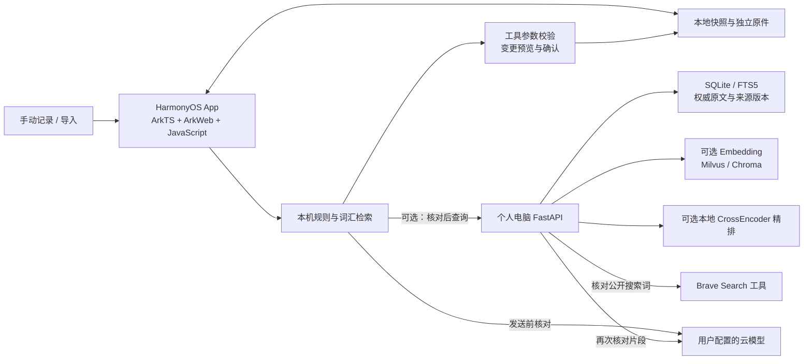

# 汐序 · Xixu Planner

**让课表、DDL、备忘录和生活资料，成为一位有出处、会追问的个人秘书。**

汐序是一款面向 HarmonyOS 的本地优先规划与知识整理应用。它把课程、作业截止、会议、展示和碎片记录放在同一个工作空间：简单安排先在本机处理，资料检索保留来源；复杂问题再按需连接个人电脑或模型。助手提出修改后，先给你核对，再写入日程。

[快速开始](#快速开始) · [核心流程](#核心流程) · [技术架构](#技术架构) · [开发与评测](#开发与评测) · [文档导航](#文档导航) · [GPL-3.0-only](LICENSE)

> **开发预览版** · HarmonyOS 应用、网页预览与可选电脑知识库服务。查看 [版本记录](CHANGELOG.md) 和 [开发记录](docs/VALIDATION_STATUS.md)。

## 为什么做汐序

课表能告诉你何时上课，却未必包含导师在群里补充的提交要求；日历能保存一个 DDL，却不一定能找回后来修改日期的通知。备忘录里还有大量尚未整理成任务的小事。

汐序围绕这些日常问题组织能力：**先把资料留好，再找出相关线索，最后由用户决定是否行动。** 产品主线是个人规划和有来源的知识检索；时间信箱则把重要事项、自己的承诺和到期后的真实反馈连起来。

## 核心流程

以下示例展示汐序的交互方式。

### 1. 一件事情可以分几句话说

```text
你：下周交作业。
汐序：具体周几？
你：周三晚上八点。
汐序：保留原事项，补全日期与时刻 → 展示预览 → 等你确认。
```

- 多会话与独立草稿；待补信息按会话隔离，避免把另一段对话的日期接过来。
- 本机规则处理明确的记录、待办和部分调课指令；不必每次都调用模型。
- 查询按实际课表、调入/调出课程、事项和学习时段核对占用；截止风险单独列出。
- 工具参数先校验，已有事项修改还要核对来源 ID 和版本。

### 2. 从资料里发现漏记的事

```text
手动导入聊天 / 文档，或保存碎片记录
→ 规则提取行动与截止线索
→ 保留原文、来源时间和版本
→ 与已有事项比对
→ 展示待核对建议
→ 你确认归自己处理，再核对并加入日程
```

例如一条“11月5号前提交开题报告”的通知，可以成为待核对事项。群体通知不会自动认定为你的任务；未知的原始时间不会用导入时间代替。已有的建议会在源内容变化后重新核对。

### 3. 问“这件事后来改了吗”

时序来源规则提取通知中的日期、地点或范围变化，保留新旧说法及出处。单条通知明确写出“原定日期 → 改后日期”时，可以并列展示；跨通知无法确认同一事项、班级或考试批次时，可选择当前采用的通知并明确适用范围，保存全部出处和来源版本；相同版本组再次提问可沿用核对结果，来源变化后重新核对。

通知依据保留来源版本，日程调整通过独立的变更预览确认。

### 4. 数据发送和日程修改都可核对

- **数据发送前**：手机发往电脑、电脑片段发往云模型，分别展示核对界面。问题、历史消息和来源片段可以编辑或排除；提供电话、邮箱、带标签编号、姓名/证件/Key模式和本机持久隐藏词表。
- **操作保存前**：展示事项、笔记或调课的前后变化。每个独立建议分别接受；同一次调课作为一组保存。
- **操作保存后**：变更日志保留前后记录。撤回时核对当前内容，避免覆盖后续编辑；支持逐组撤回，并可从每日首次使用或手动保存的完整业务快照按日期恢复。
- **模型回复中**：提供流式文字、停止和超时处理；未完整结束的结构化动作不会执行。

### 5. 时间信箱：给之后的自己留一句话

用户主动启用并选择重要事项后，可收到基于真实记录、以未来视角写来的信：

```text
重要事项临近 → 拆信 → 封存一句回信 → 到期对账 → 留下允许下次引用的真话
```

信箱可按重要事项开启，支持温柔、实话和直接三种语气，以克制的频率送达。来信取材于已记录的事项、时间、标记状态和用户授权复用的原话，将来信、回信与到期对账连成一段可回看的记录。

## 规划、记录与导入

- 今天视图、日历、每周课表、个人待办与到期事项。
- 自然语言速记、课程调整、备忘录、碎片记录和上次编辑时间。
- 液态玻璃导航与主题色界面；信封、变更对照和会话沿用同一配色，支持减少动态效果。
- 完整手机 ZIP 备份/恢复源码：快照包含课程、事项、笔记、碎片、对话、信箱与变更记录，并打包仍被引用的独立图片和原始文档；以 SHA-256、CRC 和清单核对后再确认替换。连接密钥不进入资料备份。

| 导入入口 | 格式与内容 | 处理方式 |
| --- | --- | --- |
| 课表 | Excel、PDF、图片 OCR | 识别课程与节次，核对后加入课表。 |
| 备忘录 / 文档 | TXT、Markdown、CSV、HTML、约定格式 JSON、DOCX、PDF、PNG / JPEG / WebP | 图文整理、原文件保留、扫描页本机 OCR 与来源追溯。 |
| 原件归档 | hdoc、旧版 DOC | 按原始字节归档，保留校验信息并提供原样导出。 |
| 电脑聊天资料 | QQ 标准 TXT；QQ、钉钉、微信的约定 JSON / CSV | 选择导出文件、预览确认，保留发言者、会话、发送时间与消息标识。 |

导入以用户选择的文件为单位，保留原件、来源时间和校验信息。详细操作见 [文档导入与数据管理](companion/LIMITS_UPGRADE.md)。

## 两种个人使用方式

| | 手机独立模式 | 可选电脑扩展模式 |
| --- | --- | --- |
| 用途 | 日常记录、导入、课表和本机检索 | 在手机资料之外检索手动导入的聊天与工作资料 |
| 电脑要求 | 电脑关机也可使用本机记录与检索 | 访问电脑资料时需要配套服务在线 |
| 检索 | 关键词、BM25 风格评分、词汇特征哈希与上下文预算 | SQLite FTS5；可选本地 Embedding、Milvus / Chroma、RRF 与轻量精排 |
| 数据保存 | App 本地快照与原件；网页预览使用浏览器存储 | SQLite 权威正文与版本，加独立原件文件 |
| 模型 | 可选配置；明确的本机指令不依赖模型 | 可选电脑模型；资料发往云端前再次核对 |

手机模式使用本机记录与词汇检索；电脑扩展提供可选的 Chroma / Milvus 索引。原文与原件独立保存，笔记同步由用户主动发起并确认。

## 技术架构



| 层次 | 技术与职责 |
| --- | --- |
| HarmonyOS 外壳 | ArkTS、ArkUI、ArkWeb；文件选择、HTTP / SSE、OCR、提醒和安全存储桥接。 |
| 应用界面 | HTML / CSS / 原生 JavaScript 模块（在 ArkWeb 内运行）；Hyalite、Lucide、Nunito；按动画帧合并流式文字更新。 |
| 秘书编排 | 本地意图规则、会话槽位、共享 JSON Schema Tool Registry、参数与版本校验、用户确认执行。 |
| 手机 RAG | 中文 n-gram、显式同义词、BM25 风格评分、384 维词汇特征哈希及来源预算。 |
| 电脑服务 | Python、FastAPI、HTTPX、SQLite / FTS5、原件哈希存储、确认导入和分块同步。 |
| 可选语义检索 | FastEmbed + 本地 `BAAI/bge-small-zh-v1.5`（512维）；Milvus / Chroma 适配；RRF 有效候选 Top20 → 轻量精排或可选本地 CrossEncoder → Top5。 |
| 联网工具与历史 | 独立 Brave Search 工具、加密搜索密钥和显式搜索核对；分块原件、ZIP64、完整业务历史快照。 |
| 模型适配 | 共享供应商配置；Chat Completions、Responses、Claude Messages 协议；SSE、请求标识、取消与超时。 |
| 观测与评测 | 有界本机处理记录、路径/工具/耗时/确认结果；独立合成数据与显式启用的离线评测脚本。 |

模型配置预设覆盖 DeepSeek、通义千问、Kimi、豆包、OpenAI、Gemini 兼容端点、Claude 和自定义 HTTPS 接口。模型名称、协议、流式输出、图片及工具能力作为独立配置项，由统一适配层组织请求。

实现入口：

- [共享工具定义](shared/tool-schemas.json)与[供应商目录](shared/provider-catalog.json)。
- [会话槽位、日程工具与变更日志](xixu-harmony/web/modules/assistant-core.js)。
- [事项建议、时序来源与时间信箱](xixu-harmony/web/modules/assistant-intelligence.js)。
- [发送核对、流式请求与级联处理](xixu-harmony/web/modules/assistant-network.js)。
- [电脑检索](companion/xixu_hub/vectors.py)、[轻量精排与线索提取](companion/xixu_hub/intelligence.py)、[单次发送审批](companion/xixu_hub/privacy.py)。
- [笔记与原件同步](companion/xixu_hub/note_sync.py)、[完整手机备份](xixu-harmony/web/modules/full-backup.js)、[ZIP64](xixu-harmony/web/modules/backup-zip.js)、[历史快照](xixu-harmony/web/modules/history-checkpoints.js)。
- [本地语义精排](companion/xixu_hub/reranking.py)、[独立网页搜索工具](companion/xixu_hub/search_tools.py)。

## 快速开始

提供网页预览、电脑扩展和 HarmonyOS 原生开发三种入口。

### 网页预览

在仓库根目录使用 Node.js 22：

```powershell
git clone https://github.com/jiajunlin949-stack/xixu-planner.git
cd xixu-planner
node work/prepare-native.cjs
node work/serve-native-preview.cjs
```

打开 `http://127.0.0.1:8767/`。预览服务监听本机，资料保存在当前浏览器，可直接体验记录、课表和本机检索。OCR、系统提醒与安全存储通过 HarmonyOS App 的原生桥接提供。

### 可选电脑服务

使用 Python 3.12：

```powershell
cd companion
python -m venv .venv
.\.venv\Scripts\python.exe -m pip install -r requirements.txt
.\.venv\Scripts\python.exe -m xixu_hub serve --open
```

默认管理页位于 `127.0.0.1:8765`。需要手机配对时使用 `serve --lan --open`，再通过管理页生成短期连接信息；手机 HTTPS 端口为 `8766`。默认文字检索不需要 Docker 或语义模型。

向量依赖、Chroma / Milvus 选择、手动聊天导入及配对说明见 [配套服务指南](companion/README.md)。扩展服务的启动、账号配置与个人资料均由使用者自己管理，不随源码提供。

### HarmonyOS 原生开发

在 DevEco Studio 中打开 `xixu-harmony/`，安装构建配置所需 SDK，并使用自己的应用身份、设备配置和签名材料。工程当前配置为 target SDK 26、兼容配置 API 12；设备和环境说明见 [开发记录](docs/VALIDATION_STATUS.md)。

Windows 构建脚本支持指定安装位置：

```powershell
$env:XIXU_DEVECO_HOME = 'C:/Program Files/Huawei/DevEco Studio'
node xixu-harmony/build-release.cjs
```

使用自己的签名完成构建后，可按应用发布流程安装到设备或分发内测。

## 开发与评测

项目提供网页回归、路由评测与检索评测脚本，便于围绕实际场景复现和改进。

```powershell
npm ci
npx playwright install chromium
npm run ci
```

路由与检索评测采用独立入口，详见 [评测说明](evaluation/README.md)。原生构建可使用 `npm run ci:full`。

## 文档导航

- [文档导入与数据管理](companion/LIMITS_UPGRADE.md)：原件归档、备份、历史快照和通知依据。
- [电脑扩展指南](companion/README.md)：资料导入、向量索引、模型配置与手机配对。
- [助手架构与交互流程](companion/ASSISTANT_UPGRADE.md)：工具调用、事项建议、时间信箱和发送核对。
- [开发与验证记录](docs/VALIDATION_STATUS.md)：实现状态、验证记录和版本信息。
- [项目规划](docs/PROJECT_STATUS_AND_PLAN.md) · [版本记录](CHANGELOG.md) · [回归工作流](https://github.com/jiajunlin949-stack/xixu-planner/actions/workflows/ci.yml)。

## 仓库结构

```text
xixu-harmony/web/modules/         应用界面、会话、工具、检索、信箱和备份
xixu-harmony/entry/src/main/ets/  ArkTS 外壳、原生桥接和桌面卡片
shared/                         工具 Schema 与供应商配置契约
evaluation/                     合成数据、离线评测入口与指标边界
companion/                      可选电脑知识库、手动导入、同步及模型适配
work/                           资源生成、预览与公开回归脚本
ci/                             网页验证和可选原生构建验证
docs/                           演示、需求与项目状态说明
```

公开仓库用于分发源码与开发资料；个人记录、原件、密钥与签名由使用者在本机管理。向量索引是可重建的检索投影，原文与原件独立保存。

## 许可与贡献

项目自有源码按 **GPL-3.0-only** 发布，见 [LICENSE](LICENSE) 与 [COPYRIGHT](COPYRIGHT)。第三方组件保留各自许可，详见 [第三方声明](THIRD_PARTY_NOTICES.md)；Hyalite 等上游实现不改称为本项目原创。许可证不授予冒充官方应用或维护者的权利。

欢迎提交可复现问题和改进建议，参见 [贡献说明](CONTRIBUTING.md) 与 [安全说明](SECURITY.md)。请勿在公开 Issue、PR、日志或截图中上传私人笔记、课表、聊天、API Key 或签名材料。
