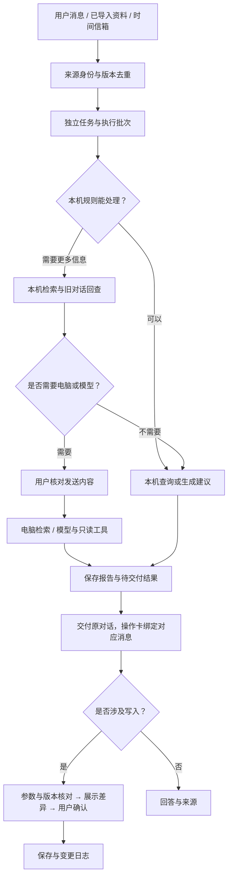

# 汐序 · Xixu Planner

**面向 HarmonyOS 的本地优先个人 Agent：把课表、DDL 和生活资料，变成有出处、可核对的行动。**

汐序将课程、会议、作业截止、备忘录和碎片记录放进同一个工作空间。明确的安排先在本机处理；需要更多信息时，再按需使用个人电脑知识库或用户配置的模型。Agent 从导入资料中发现事项、查找历史通知、提出日程修改，并把来源和前后变化交给用户核对。

`ArkTS / ArkWeb` · `JavaScript` · `FastAPI` · `SQLite / FTS5` · `RRF / Rerank` · `JSON Schema` · `SSE`

[技术亮点](#核心工程能力) · [Agent 流程](#agent-工作流) · [技术栈](#技术栈) · [演示](#五分钟演示) · [快速开始](#快速开始) · [代码导航](#代码导航)

## 项目解决什么

- **临时通知没有进入日程**：从用户手动导入的群聊、通知或笔记中提取行动和截止线索，与现有事项比对后展示建议。
- **安排分散，历史信息容易混淆**：连接课程、DDL、备忘录和碎片记录，保留发言者、来源时间、版本与原文引用。
- **AI 能回答，却难以放心执行**：工具参数先校验；发送资料前核对内容，修改安排前核对差异，保存后保留变更记录。

产品主线是 **资料留存 → 有据检索 → 事项建议 → 用户确认 → 可追溯保存**。

## 核心工程能力

| 能力 | 工程实现 | 解决的问题 |
| --- | --- | --- |
| **规则优先的 Agent 路由** | 本机意图规则、按会话隔离的日期/时间槽位、JSON Schema Tool Registry；复杂问题按需进入模型流程 | 简单操作无需每次调用模型，模糊安排可以继续补充 |
| **任务与网络连接解耦** | Trigger / Thread / Ticket / Assignment、内容游标、执行队列、结构化状态与持久 Outbox | 保存任务归属、执行批次和交付记录，支持多对话处理与中断后接续 |
| **可追溯的混合 RAG** | 手机词汇检索；电脑 SQLite FTS5 / 向量召回、RRF、轻量精排与可选 CrossEncoder；来源带版本和片段位置 | 回答可以定位原文，检索索引可以重建，通知变化有据可查 |
| **主动事项发现** | 从已保存资料提取“行动＋时间”线索，去重并保留证据；源内容更新后重新核对 | 发现可能漏记的 DDL，而不擅自把群体通知认定为个人任务 |
| **Human-in-the-loop** | 资料发送核对、隐藏词表、参数校验、版本检查、变更 Diff、原子快照与撤回记录 | 将模型建议和真实写入分开，降低误改和资料误发的风险 |
| **统一模型与流式交互** | 供应商配置与协议适配、SSE 分片处理、请求 ID、取消和超时；按帧合并文字刷新 | 模型连接与业务逻辑分离，多个请求保持各自上下文 |
| **数据完整性与恢复** | 原件独立归档、SHA-256 / CRC 清单、ZIP64、分块读写、来源时间与历史快照 | 资料保留不依赖向量索引，备份涵盖正文、图片与被引用的原件 |
| **面向维护的职责分离** | 领域引擎、执行调度、消息结果、工作台、网络协议分别维护；统一状态转换与结果解析 | 减少重复请求路径和全局状态同步，便于定位问题与扩展 |

## Agent 工作流



- 多会话拥有独立草稿、请求和消息引用；重试旧问题使用原问题之前的历史。
- 同一任务可先后经历多个执行批次。等待发送核对时让出执行槽，前台用户任务优先。
- 模型可按需查笔记、查实际日程或回查旧消息；新增本机证据再次核对后才发送。
- 报告先保存，再通过固定消息 ID 交付。中断请求保留恢复入口，日程写入不会因恢复而自动回放。
- 工作台按页呈现待补充、待确认、失败与中断事项；正常进展不逐步弹通知。

## 从记忆到行动

### 会接话的安排

```text
你：下周交作业。
汐序：具体周几？
你：周三晚上八点。
汐序：补全原事项的日期与时刻 → 展示建议 → 等待确认。
```

查询会分别展示课表/事项占用和截止压力；课程互换、单次调课等操作先生成预览，再按核对结果保存。

### 从资料中发现可能漏记的事

```text
手动导入“11月5号前提交开题报告”的通知
→ 提取行动与截止线索
→ 保留原文、来源时间和版本
→ 与现有事项比对
→ 用户核对是否与自己有关
→ 确认后加入日程
```

### 有时间线的来源

通知中的原定时间与变更时间可以并列查看。跨通知存在班级、批次等歧义时，由用户选择采用依据；依据绑定源版本，原文改变后重新核对。

### 时间信箱

用户为重要事项启用来信后，可收到基于真实记录、以未来视角写成的信，并封存回信和到期后的真实反馈。取材来自事项、时间、实际标记和获准复用的用户原话，形成可回看的个人记录。

## 本机与电脑协同

| 使用方式 | 数据与检索 | 适合的场景 |
| --- | --- | --- |
| **手机本机** | 课程、日程、备忘录、碎片记录、本机规则和词汇检索；模型按需配置 | 日常记录、安排和查询，电脑关机也可使用本机功能 |
| **个人电脑扩展** | FastAPI、SQLite / FTS5、原件存储，可选 Milvus / Chroma、Embedding 与 Rerank | 在已手动导入的更多聊天和工作资料中检索 |

SQLite 与原件存储负责保留资料，向量库负责可重建的检索投影。手机通过配对连接个人电脑，资料与模型请求分别核对。

## 技术栈

| 层次 | 技术与职责 |
| --- | --- |
| 手机外壳 | ArkTS、ArkUI、ArkWeb；文件选择、HTTP / SSE、OCR、系统提醒与安全存储桥接 |
| 应用界面 | HTML / CSS / 原生 JavaScript，按 manifest 组合离线资源；Hyalite、Lucide、Nunito |
| Agent 编排 | 确定性路由、会话槽位、JSON Schema 工具、持久任务状态、授权与变更确认 |
| 手机检索 | 中文 n-gram、显式词汇别名、BM25 风格评分、词汇特征哈希、来源及上下文预算 |
| 电脑服务 | Python、FastAPI、HTTPX、SQLite / FTS5、原件归档与分块同步 |
| 可选语义检索 | FastEmbed、Milvus / Chroma、RRF 融合、轻量精排或本地 CrossEncoder |
| 模型协议 | Chat Completions、Responses、Claude Messages；独立供应商配置、SSE、取消及超时 |
| 观测与评测 | 有界本机处理记录、路由/工具/耗时/确认结果；合成数据与显式运行的离线评测 |

模型预设包含 DeepSeek、通义千问、Kimi、豆包、OpenAI、Gemini 兼容端点、Claude 和自定义 HTTPS 接口。模型名称、协议和能力项可独立配置。

## 文档导入与数据管理

| 入口 | 文件与内容 | 处理方式 |
| --- | --- | --- |
| 课表 | Excel、PDF、图片 OCR | 识别课程与节次，核对后加入课表 |
| 备忘录 / 文档 | TXT、Markdown、CSV、HTML、约定 JSON、DOCX、PDF、PNG / JPEG / WebP | 图文整理、原件保留、扫描页本机 OCR 与来源追溯 |
| 原件归档 | hdoc、旧版 DOC | 按原始字节保存，记录校验信息并提供原样导出 |
| 电脑聊天资料 | QQ 标准 TXT；QQ、钉钉、微信的约定 JSON / CSV | 手动选择、预览确认，保留发言者、会话、发送时间与消息标识 |

备忘录记录上次编辑时间。完整 ZIP 备份携带业务快照及仍被引用的图片与原件，模型密钥和设备配对凭据单独管理。

## 五分钟演示

使用合成资料展示：**多轮补全安排 → 来源检索 → 消息内操作卡 → 变更核对与撤回 → 多会话与工作台**。

- [五分钟演示步骤](docs/DEMO.md)
- [设计适配与任务链路](docs/SUPER_AGENT_ADAPTATION.md)

## 快速开始

### 网页开发预览

需要 Node.js 22，在仓库根目录执行：

```powershell
git clone https://github.com/jiajunlin949-stack/xixu-planner.git
cd xixu-planner
node work/prepare-native.cjs
node work/serve-native-preview.cjs
```

浏览器打开 `http://127.0.0.1:8767/`。网页适合展示界面与本机规则，原生文件、模型、OCR 和系统提醒通过手机桥接运行。

### 个人电脑与 HarmonyOS

- [电脑扩展配置、配对与导入](companion/README.md)
- [HarmonyOS 工程与签名说明](docs/NATIVE_BUILD.md)

## 代码导航

| 入口 | 阅读重点 |
| --- | --- |
| [assistant-engine.js](xixu-harmony/web/modules/assistant-engine.js) | 准入、授权、任务状态、执行批次、交付回执与确认准备 |
| [assistant-runtime.js](xixu-harmony/web/modules/assistant-runtime.js) | 运行队列、上下文、取消、前台监督和来源接入 |
| [assistant-results.js](xixu-harmony/web/modules/assistant-results.js) | 消息绑定、编辑草稿、结果交付与恢复 |
| [assistant-workbench.js](xixu-harmony/web/modules/assistant-workbench.js) | 工作台分页、展示与用户命令 |
| [assistant-network.js](xixu-harmony/web/modules/assistant-network.js) | 发送核对、协议适配、SSE 和有界工具流程 |
| [assistant-core.js](xixu-harmony/web/modules/assistant-core.js) | 参数校验、多轮槽位、日程 Diff 与版本核对 |
| [assistant-intelligence.js](xixu-harmony/web/modules/assistant-intelligence.js) | 事项建议、时序来源规则与时间信箱 |
| [vectors.py](companion/xixu_hub/vectors.py) / [reranking.py](companion/xixu_hub/reranking.py) | 电脑检索、向量适配与精排 |
| [共享工具定义](shared/tool-schemas.json) / [供应商目录](shared/provider-catalog.json) | 工具和模型配置契约 |

## 开发与验证

提供网页回归、路由和检索评测入口：

```powershell
npm ci
npx playwright install chromium
npm run ci
```

路由评测包含 50 条合成意图用例，检索评测包含 30 个问题；指标定义与运行方法见 [评测说明](evaluation/README.md)。提交、环境和实际结果一起记录，不使用预期数字代替实测。

任务编排与代码整理的验证记录见 [开发状态](docs/VALIDATION_STATUS.md) 和 [代码审查记录](docs/CODE_CLEANUP.md)。代码能力、网页回归、真实模型连接和鸿蒙真机验收分别记录。

## 许可与贡献

项目自有源码按 **GPL-3.0-only** 发布，见 [LICENSE](LICENSE) 与 [COPYRIGHT](COPYRIGHT)。第三方组件保留各自许可，详见 [第三方声明](THIRD_PARTY_NOTICES.md)。设计参考与适配范围见 [设计说明](docs/SUPER_AGENT_ADAPTATION.md)。

欢迎提供可复现问题和改进建议，参见 [贡献说明](CONTRIBUTING.md) 与 [安全说明](SECURITY.md)。请勿在公开 Issue、PR、日志或截图中上传私人资料、API Key 或签名材料。
